# Pizzaria Marquês

A web shop for a (fictional) neighbourhood pizzeria in Oeiras, Lisbon: browse the menu, build a cart,
check out with delivery or pick-up, and manage a customer profile. Built with Django, server-rendered,
with a small, hand-tuned front end.

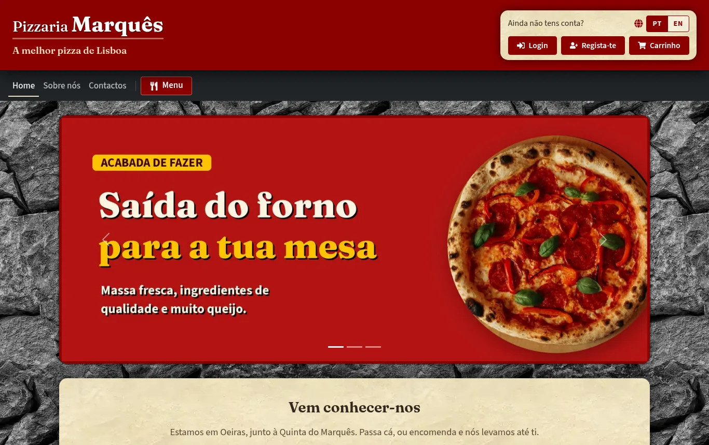

## Contents

- [Features](#features)
- [Screenshots](#screenshots)
- [Tech stack](#tech-stack)
- [Getting started](#getting-started)
- [Project structure](#project-structure)
- [High-level design](#high-level-design)
- [Front-end build and performance](#front-end-build-and-performance)
- [Image pipeline](#image-pipeline)
- [Design language](#design-language)
- [Credits](#credits)

## Features

| Area | What it does |
|---|---|
| Menu | Pizzas (named after Portuguese kings), sides, drinks and desserts, each with a photo and price; add to cart with a quantity |
| Cart and checkout | Delivery or restaurant pick-up, registered or new address, cash / card / MB WAY; totals are computed server-side |
| Accounts | Registration with address and phone, login/logout, profile page with photo upload |
| Content pages | Home with a hero carousel, *Sobre nós* (the pizzeria's story), *Contactos* with a map |
| Responsive | Layouts for 320 px phones up to large desktops; images served at the size and format each device needs |
| Accessibility | Skip link, landmarks, labelled forms, visible focus, AA contrast, no auto-rotating carousel until the visitor engages, `prefers-reduced-motion` respected |

## Screenshots

| Menu | Sobre nós |
|---|---|
| 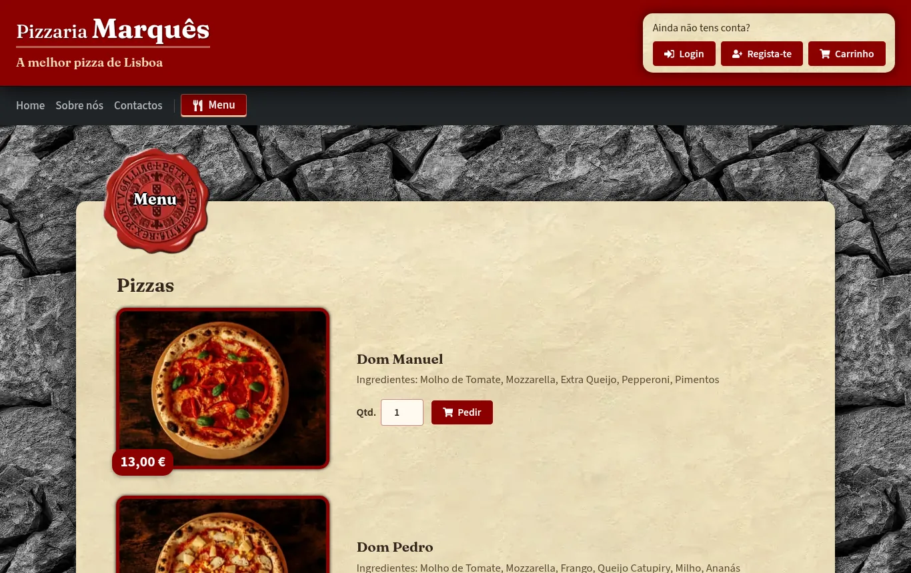 | 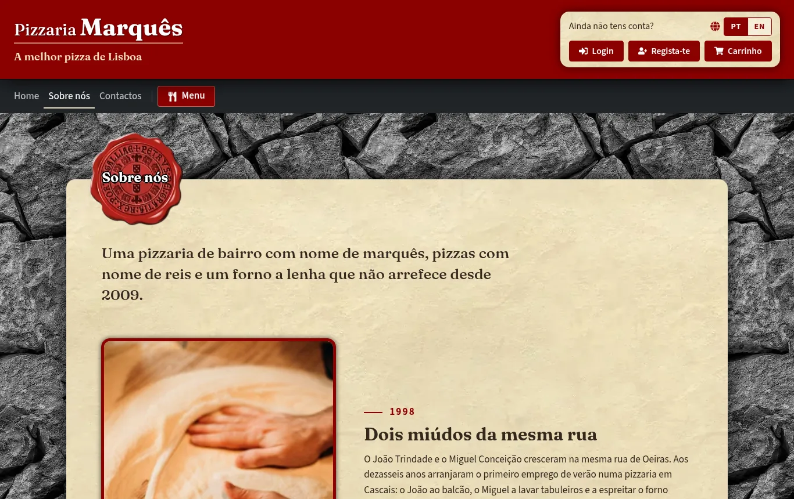 |

| Contactos | Login |
|---|---|
| 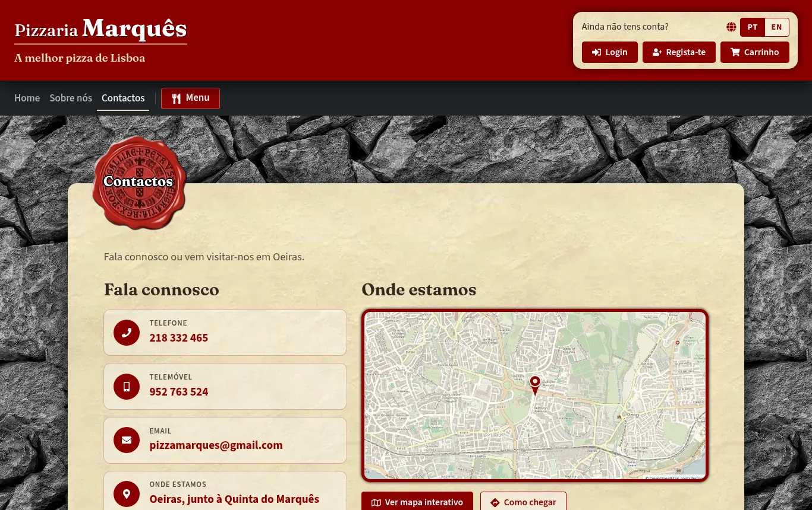 | 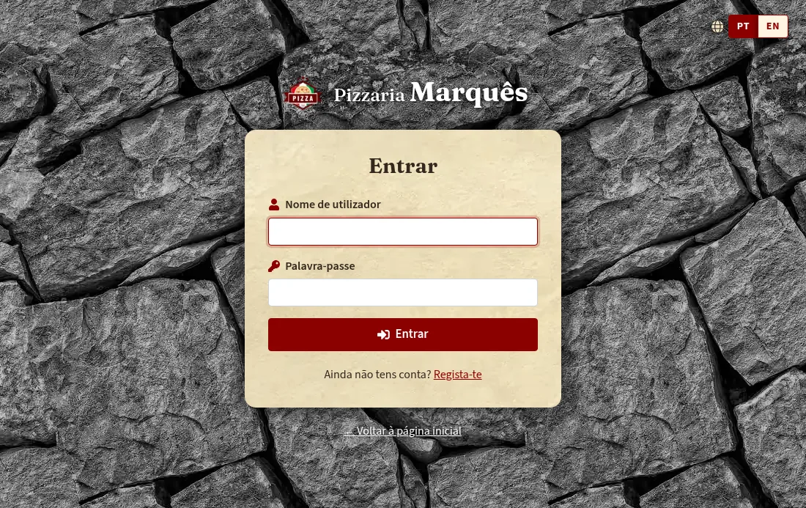 |

On phones (390 px): home, menu and *Sobre nós*.

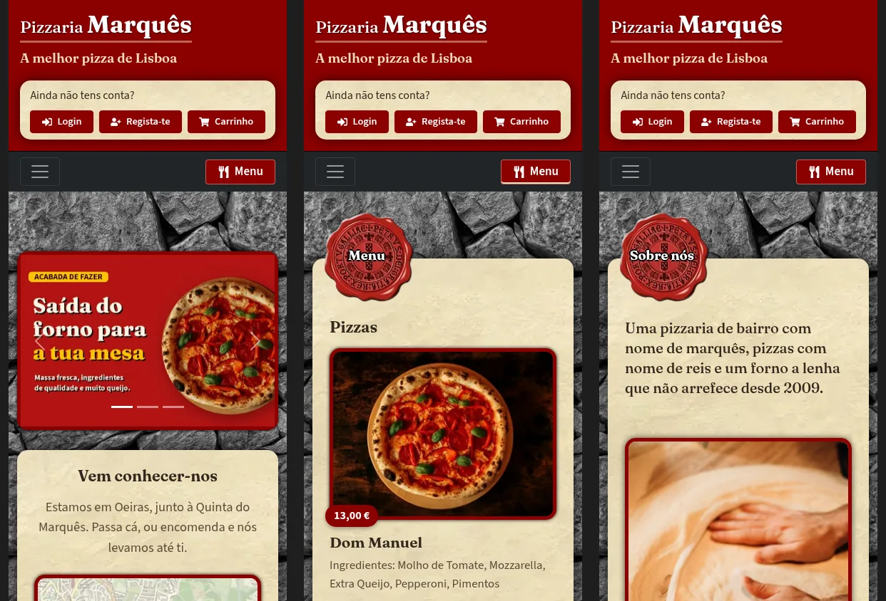

## Tech stack

| Layer | Technology |
|---|---|
| Language | Python 3.9–3.10 (the range Django 3.2 supports), HTML (Django Template Language), CSS, JavaScript (ES2019) |
| Web framework | Django 3.2 (MVT, ORM, auth, messages, sessions, staticfiles) |
| Database | PostgreSQL 17 in Docker; SQLite (`db.sqlite3`, not committed) for local development |
| Deployment | Docker Compose: gunicorn app container, PostgreSQL container, Cloudflare Tunnel (`cloudflared`) for public HTTPS |
| Images | Pillow 11.3+ (resizing, AVIF / WebP / JPEG encoding) |
| Static file serving | WhiteNoise 6.5 (hashed file names, Brotli/gzip, immutable caching) |
| UI toolkit | Bootstrap 5.0 (grid, carousel, collapse, alerts), purged to the classes the templates use |
| Typefaces | Fraunces and Source Sans 3, self-hosted variable fonts (SIL OFL) |
| Icons | Font Awesome Free 5.15 icons, inlined as SVG (CC BY 4.0) |
| Maps | OpenStreetMap: static map image, interactive embed loaded on request |
| Build tooling | Node.js, esbuild (JS bundle), PurgeCSS + Lightning CSS (CSS), fontTools (font subsetting) |
| Quality tooling | Lighthouse 12 + Puppeteer (navigation, timespan and snapshot audits) |

## Getting started

### Run the site

```bash
# Python environment (any tool works; uv shown here)
uv venv --python 3.9 .venv
source .venv/bin/activate
uv pip install -r requirements.txt

python manage.py migrate
python manage.py gerar_variantes   # responsive sizes for product photos and avatars
python manage.py runserver
```

Open http://127.0.0.1:8000/.

`migrate` creates the tables and, on an empty database, the menu (categories and products, see
`sitepizza/migrations/0029_catalogo_inicial.py`). There is no separate schema file.

### Run with Docker

Three containers:

- `web`: Django served by gunicorn.
- `db`: PostgreSQL.
- `cloudflared`: a Cloudflare Tunnel that publishes the site over HTTPS without opening any port
  on the server.

```bash
cp .env.example .env      # then fill it in (see below)
docker compose up -d --build
docker compose exec web python manage.py createsuperuser   # account for /admin/
```

Settings in `.env`:

| Variable | Value |
|---|---|
| `DJANGO_SECRET_KEY` | long random string: `python3 -c "import secrets; print(secrets.token_urlsafe(50))"` |
| `POSTGRES_PASSWORD` | database password |
| `DJANGO_ALLOWED_HOSTS` | the public domain, plus `localhost,127.0.0.1` for checks from the server itself. Requests for any other host get a 400 |
| `CLOUDFLARE_TUNNEL_TOKEN` | token of the tunnel, from the Cloudflare Zero Trust dashboard |
| `WEB_PORT` | optional; local port for `web` (default 8000) |

In the Cloudflare dashboard, point the tunnel's public hostname at `http://web:8000`, the service
name on the Compose network. `localhost` there would mean the cloudflared container itself.

`web` is only published on `127.0.0.1:${WEB_PORT}`, so from outside the server the site is reachable
only through Cloudflare. To try the stack locally without a tunnel, set `CLOUDFLARE_TUNNEL_TOKEN` to
any placeholder, run `docker compose up -d --build db web`, and open http://localhost:8000/.

- The `web` container runs `migrate` every time it starts, so a new database is set up
  automatically and updates apply their migrations.
- Data lives in two named volumes: `pgdata` (the database) and `storage` (product photos and
  profile photo uploads). `docker compose down` keeps them; `docker compose down -v` deletes them.
- To update: `git pull && docker compose up -d --build`.
- Backup: `docker compose exec db pg_dump -U pizzaria pizzaria > backup.sql`.
- With `DEBUG` off, Django trusts Cloudflare's `X-Forwarded-Proto` header to know the visitor is on
  HTTPS, and marks the session and CSRF cookies as HTTPS-only.

The compiled CSS/JS (`sitepizza/static/dist/`) is committed, so Node.js is only needed to change the
front end.

### Change the front end

```bash
npm install
npm run build          # sitepizza/assets/{css,js} -> sitepizza/static/dist/*.min.{css,js}
```

Edit `sitepizza/assets/css/style.css` and `sitepizza/assets/js/site.js`, never the files in `dist/`.
To re-trim the fonts (only needed when the weights or characters change):
`pip install fonttools brotli && python tools/subset-fonts.py`.

### Production-like run

Without Docker:

```bash
export DJANGO_DEBUG=0
export DJANGO_SECRET_KEY=<random string>   # required when DEBUG is off
export DJANGO_ALLOWED_HOSTS=localhost,127.0.0.1
python manage.py collectstatic --noinput   # hashed + compressed copies in staticfiles/
python manage.py runserver
```

The committed `SECRET_KEY` in `settings.py` is public, so it is used only as a development fallback;
with `DEBUG` off the app refuses to start without `DJANGO_SECRET_KEY`.

With `DEBUG` off, WhiteNoise serves static files with one-year immutable cache headers, and uploads
are served from `/media/` with a one-year `Cache-Control` (every upload gets a new key, so a file is
never overwritten in place).

### Uploads and the storage bucket

Uploaded content never mixes with the code or the app's own assets. `MEDIA_ROOT` points to
`storage/`, a local stand-in for an object storage bucket (S3, GCS, ...), served at `/media/`.
Each upload gets its own directory, named with a readable prefix and a random key, holding the
original and its generated sizes:

```text
storage/avatars/utilizador-7-1a2b3c4d/original.jpg
storage/avatars/utilizador-7-1a2b3c4d/320.avif   320.webp   320.jpg   ...
```

Replacing or deleting an image removes its whole directory, so the bucket holds no orphaned files.
Moving to a real bucket only means swapping Django's storage backend (for example
`django-storages`); paths and templates stay the same.

### Lighthouse audits

```bash
# against a running production-like server and a test account
BASE=http://127.0.0.1:8000 OUT=lighthouse-reports LH_USER=<user> LH_PASS=<password> \
  node tools/lighthouse-run.mjs          # add "quick" for the short matrix
```

Writes an HTML + JSON report per run and a `summary.json`.

## Project structure

```text
.
├── docs/
│   └── images/                          README screenshots and the original UML diagram
├── PizzariaMarques/                     Django project
│   ├── __init__.py
│   ├── asgi.py
│   ├── settings.py
│   ├── urls.py
│   └── wsgi.py
├── sitepizza/                           the application
│   ├── assets/                          front-end sources (not served)
│   │   ├── css/
│   │   │   └── style.css
│   │   ├── fonts/                       trimmed variable fonts (output of tools/subset-fonts.py)
│   │   │   ├── fraunces-pt-wght.woff2
│   │   │   └── source-sans-3-pt-wght.woff2
│   │   └── js/
│   │       └── site.js
│   ├── management/
│   │   ├── __init__.py
│   │   └── commands/
│   │       ├── __init__.py
│   │       └── gerar_variantes.py       backfills responsive image sizes
│   ├── migrations/                      schema history; 0027-0029 are data migrations (0029 seeds the menu)
│   ├── static/                          the app's own assets (never uploads)
│   │   ├── dist/
│   │   │   ├── site.min.css
│   │   │   └── site.min.js
│   │   ├── fonts/
│   │   │   ├── fraunces-pt-wght.woff2
│   │   │   └── source-sans-3-pt-wght.woff2
│   │   └── img/                         one directory per image, one file per size/format
│   │       ├── avatar/                  40.webp  80.webp  200.png
│   │       ├── banners/
│   │       │   ├── entradas/            480 630 720 945 1260 (.avif .webp .jpg)
│   │       │   ├── entradas-largo/      1260 1890 2520 (.avif .webp .jpg)
│   │       │   ├── forno/
│   │       │   ├── forno-largo/
│   │       │   ├── online/
│   │       │   └── online-largo/
│   │       ├── favicon/                 32.png  180.png
│   │       ├── fundo-pedra/             400 and 640 (.avif .webp .jpg)
│   │       ├── logo/                    80.webp  160.webp
│   │       ├── mapa-oeiras/             480 640 960 1024 1280 (.avif .webp .jpg), CREDITOS.txt
│   │       ├── papiro/                  640 (.avif .webp .jpg)
│   │       ├── selo/                    205 (.avif .webp)
│   │       └── sobre/                   CREDITOS.txt
│   │           ├── amigos/              400 480 600 800 1000 (.avif .webp .jpg)
│   │           ├── caderno/
│   │           ├── forno/
│   │           ├── hoje/
│   │           └── nome/
│   ├── templates/
│   │   └── sitepizza/
│   │       ├── base.html                document shell: head, fonts, CSS, JS
│   │       ├── template.html            site layout: header, account card, navbar, messages, footer
│   │       ├── home.html
│   │       ├── menu.html
│   │       ├── sobrenos.html
│   │       ├── contactos.html
│   │       ├── checkout.html
│   │       ├── finalizar.html
│   │       ├── perfil.html
│   │       ├── login.html
│   │       ├── registo.html
│   │       ├── _campo.html              partial: labelled form field
│   │       ├── _foto_sobre.html         partial: About-page photo
│   │       ├── _mapa.html               partial: static map + interactive map on request
│   │       ├── _produto.html            partial: menu product card
│   │       └── _selo.html               partial: wax-seal page title
│   ├── templatetags/
│   │   ├── __init__.py
│   │   ├── icones.py                    
│   │   └── imagens.py                   
│   ├── __init__.py
│   ├── admin.py
│   ├── apps.py                          signal handlers that keep the bucket in sync
│   ├── forms.py
│   ├── icones_svg.py                    generated: SVG paths of the icons in use
│   ├── imagens.py                       responsive image generation, lookup and cleanup
│   ├── models.py
│   ├── urls.py
│   └── views.py
├── storage/                             storage bucket (MEDIA_ROOT, served at /media/)
│   ├── avatars/                         profile photo uploads (not committed)
│   │   └── utilizador-<id>-<key>/       original.<ext> + 160/320/... variants
│   └── produtos/                        product catalogue, CREDITOS.txt
│       ├── dom-manuel/                  original.jpg + 160 320 480 640 960 1280 (.avif .webp .jpg)
│       └── ...                          one directory per product
├── tools/
│   ├── build-assets.mjs                 CSS/JS/font/icon build
│   ├── lighthouse-run.mjs               Lighthouse test matrix
│   └── subset-fonts.py                  font trimming
├── .dockerignore
├── .env.example                         settings for docker compose (copy to .env)
├── .gitignore
├── docker-compose.yml                   web, db and cloudflared containers, volumes
├── docker-entrypoint.sh                 seeds the storage volume, runs migrate
├── Dockerfile
├── manage.py
├── package.json
├── package-lock.json
├── README.md
└── requirements.txt
```

## High-level design

### Architecture

The site is a classic server-rendered Django application following the Model-View-Template pattern.
JavaScript is a progressive enhancement: every page and form works without it.

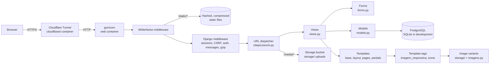

### Data model

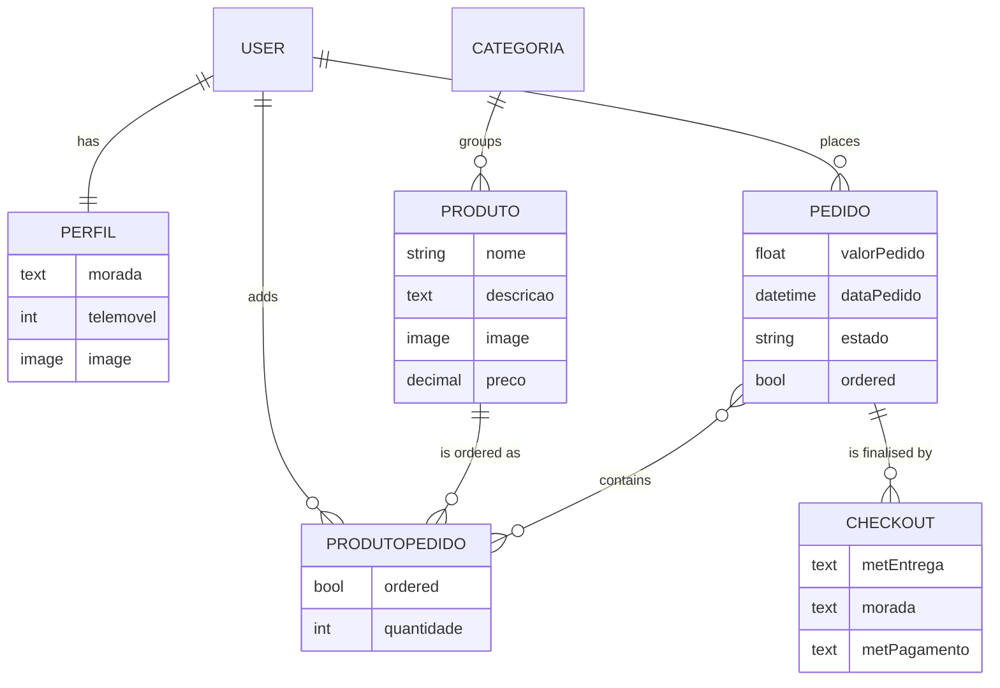

The original class diagram from the project report is in [`docs/images/diagrama-uml.png`](docs/images/diagrama-uml.png).

### Order flow

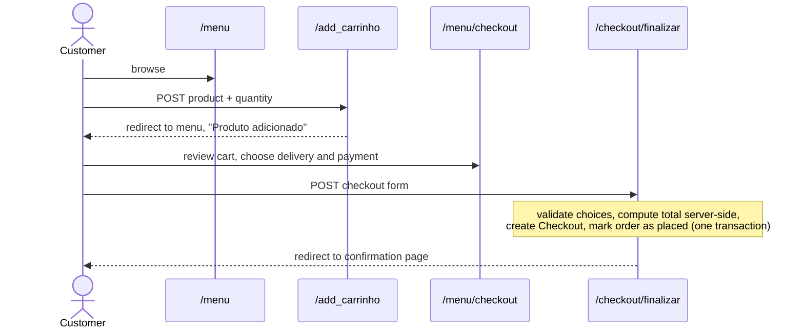

### Design patterns and principles

| Pattern / principle | Where |
|---|---|
| Model-View-Template | Django's request handling: `models.py`, `views.py`, `templates/` |
| Template inheritance (Template Method) | `base.html` defines the document skeleton and blocks; `template.html` fills in the site layout; pages override `static`, `titulo`, `descricao`, `preload`. Login/registration extend `base.html` directly, keeping the background but not the shop layout |
| Composition through partials | `_produto.html`, `_mapa.html`, `_selo.html`, `_campo.html`, `_foto_sobre.html` are parameterised with `` |
| Facade | `` hides variant lookup, formats, `srcset`/`sizes`, dimensions and loading hints behind one tag |
| Observer | `pre_save`, `post_save` and `post_delete` signals on `Produto` and `Perfil` (connected in `SitepizzaConfig.ready()`) generate image sizes on upload and remove replaced or deleted image directories |
| Command | `manage.py gerar_variantes` (a `BaseCommand` subclass) backfills sizes for existing images |
| Data migration | `0027_imagens_produtos` points products at the new photo set; `0028_storage_bucket` moves uploads into the bucket layout; `0029_catalogo_inicial` creates the menu on an empty database. All reproducible instead of by hand |
| Inheritance and encapsulation (OOP) | `CreateUserForm` extends `UserCreationForm`; `PerfilForm` is a `ModelForm`; models own their behaviour (`Pedido.subtotal()`, `ProdutoPedido.precoprodutos()`, `__str__`) |
| Progressive enhancement | The map is a static image until "Ver mapa interativo" is clicked; checkout options work without JS; the carousel only auto-rotates after the visitor interacts |
| Configuration via environment | `DJANGO_DEBUG`, `DJANGO_SECRET_KEY`, `DJANGO_ALLOWED_HOSTS` and `POSTGRES_*` select development or production behaviour and the database without code changes; secrets stay out of the repository |

### Practices applied

- **Security:** CSRF tokens on every form, `@require_POST` on state-changing views, `@login_required`
  on account and order views, totals computed on the server instead of trusted from the form,
  `rel="noopener"` on external links, and the third-party map iframe loaded with `referrerpolicy="no-referrer"`.
  In production the secret key and database password come from `.env` (never committed), cookies are
  HTTPS-only, and the app port is bound to localhost, so traffic only arrives through the tunnel.
- **Accessibility:** semantic landmarks (`header`, `nav`, `main`, `footer`), one `h1` per page, labelled inputs and
  fieldsets, a skip link, visible focus styles, WCAG AA contrast, `aria-current` on the active page,
  hidden text for icon-only buttons.
- **Performance:** see [Front-end build and performance](#front-end-build-and-performance).
- **Maintainability:** CSS design tokens (custom properties), build sources separated from build output,
  generated files marked as generated, credits stored next to the assets they cover.

## Front-end build and performance

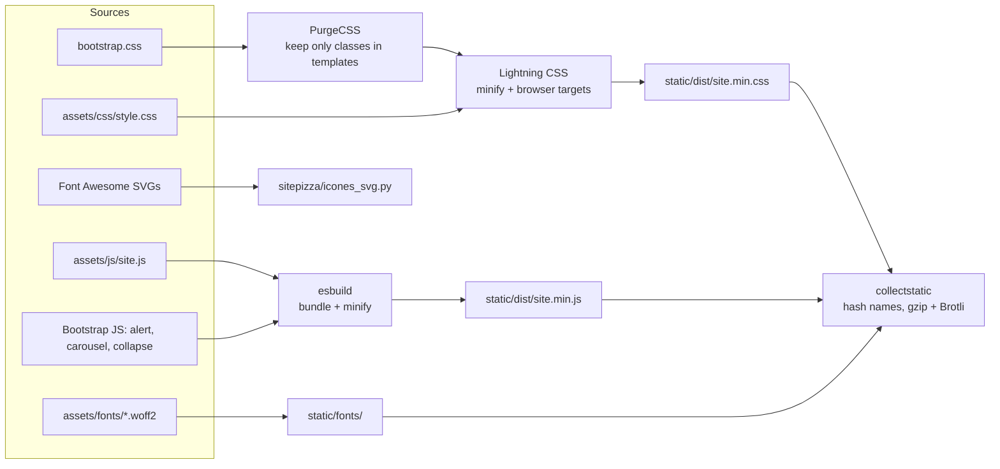

What the build and templates do, and why:

| Technique | Effect |
|---|---|
| Purged Bootstrap + one minified stylesheet | 30 KB CSS (7.4 KB compressed) instead of 155 KB Bootstrap + extra stylesheets |
| One JS bundle with only the components in use | 7 KB compressed; no jQuery, no second Bootstrap version |
| Inline SVG icons | no icon font or icon stylesheet blocking the first paint |
| Self-hosted, preloaded, trimmed variable fonts | about 40 KB for both families; metric-matched fallbacks keep the layout from shifting while they load |
| Seamless texture tiles | 640 px stone and parchment tiles (73 KB and 13 KB as AVIF) replace 1.6 MB and 0.5 MB photos; phones get a 21 KB stone tile |
| Responsive images | AVIF, then WebP, then JPEG, each in several widths, with `sizes` matching the layout |
| Loading hints | the first visible image is preloaded with `fetchpriority="high"`; images further down load lazily |
| Static map facade | no Maps JavaScript on page load |
| Long-term caching | hashed file names with immutable caching for static files; one year for uploads |

### Lighthouse results

Measured on a production-like run (`DEBUG` off, WhiteNoise) with Lighthouse 12.2.1. Scores are
Performance / Accessibility / Best Practices / SEO.

| Page | Mobile | Desktop | Desktop, DevTools throttling |
|---|---|---|---|
| Home | 100 / 100 / 100 / 100 | 100 / 100 / 100 / 100 | 100 / 100 / 100 / 100 |
| Menu | 100 / 100 / 100 / 100 | 100 / 100 / 100 / 100 | 100 / 100 / 100 / 100 |
| Sobre nós | 100 / 100 / 100 / 100 | 100 / 100 / 100 / 100 | 100 / 100 / 100 / 100 |
| Contactos | 99 / 100 / 100 / 100 | 100 / 100 / 100 / 100 | 100 / 100 / 100 / 100 |
| Login / Registo | 100 / 100 / 100 / 100 | 100 / 100 / 100 / 100 | 100 / 100 / 100 / 100 |
| Checkout (logged in) | | 100 / 100 / 100 / 100 | |

Cumulative Layout Shift is 0 on every page, and Total Blocking Time is 0–30 ms. Timespan flows
(mobile navigation, carousel and map on the home page; scrolling the menu and adding to the cart)
score 100 with INP of 40–60 ms.

Page weight went from 3.3–3.8 MB to 150–340 KB on desktop and 100–410 KB on mobile.

Known gaps: on a simulated low-end phone over slow 3G (400 Kbps), Performance is 78–83. On tablets,
Best Practices drops to 96 because the wax-seal image (205 px wide) is below 2x resolution.

## Image pipeline

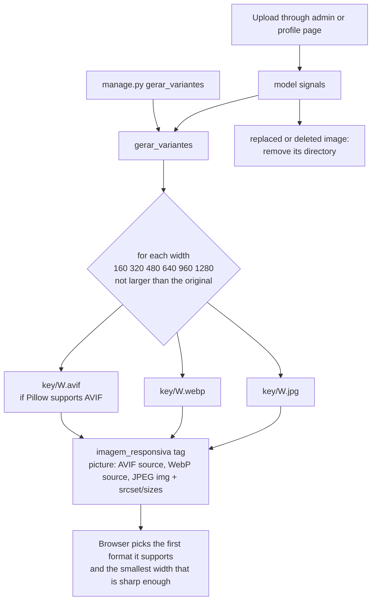

A budget phone downloads a 320 px file and a 4K screen a 1280 px one, from the same template code.
Variant files sit in the same directory as the original, so they're found without a database
lookup, and the whole group is removed in one step when the image is replaced or deleted.

## Design language

- **Palette:** deep red (`#8b0000`) header and buttons, cream accents (`#f0e0c0`), parchment cards on a
  dark stone wall, and a wax seal carrying each page title.
- **Typography:** two families with different jobs.
  - *Fraunces* (500–700) for the brand, headings, seal labels, the About story and prices: a warm,
    old-world serif that suits the parchment and the seal.
  - *Source Sans 3* (400–700) for navigation, buttons, forms, ingredient lists and contact details:
    neutral and very legible at small sizes.
  - Hierarchy comes from weight and size within each family.
- **Photography:** one colour grade across the product photos (slightly warm, a touch more contrast, a
  soft vignette), consistent crops (4:3 products, 4:5 story photos), most pizzas from a single shoot
  on dark wood.

## Credits

- Product and story photos: [Pexels](https://www.pexels.com/license/), free to use. The source of every
  photo is listed in `storage/produtos/CREDITOS.txt` and
  `sitepizza/static/img/sobre/CREDITOS.txt`.
- Map: © [OpenStreetMap](https://www.openstreetmap.org/copyright) contributors (ODbL), with attribution in the image.
- Icons: [Font Awesome Free](https://fontawesome.com/license/free) (CC BY 4.0).
- Fonts: [Fraunces](https://github.com/undercasetype/Fraunces) and
  [Source Sans 3](https://github.com/adobe-fonts/source-sans) (SIL Open Font License).
- The pizzeria, its story and its people are fictional.
